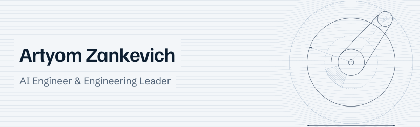

<picture>
  <source media="(prefers-color-scheme: dark)" srcset="header-dark.svg">
  <source media="(prefers-color-scheme: light)" srcset="header-light.svg">
  
</picture>

I'm an AI engineer and engineering leader at Akveo in Vilnius.

I build AI agents, voice agents and LLM features, and create plugins for Claude Code and Codex. I prototype AI features myself and lead web development at Akveo.

I work with TypeScript, OpenAI, Anthropic Claude and MCP.

---

[LinkedIn](https://www.linkedin.com/in/zankevich) | [X](https://x.com/ArtyomZankevich) | [Website](https://www.zankevich.com/) | [CV (PDF)](https://www.zankevich.com/cv/artyom-zankevich-cv.pdf)
