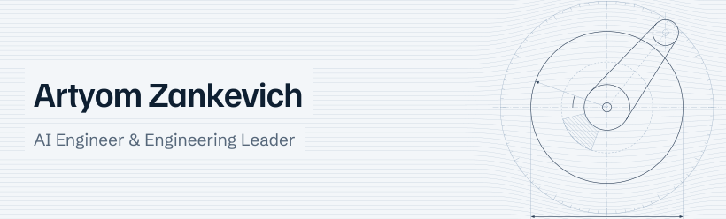

<picture>
  <source media="(prefers-color-scheme: dark)" srcset="header-dark.svg">
  <source media="(prefers-color-scheme: light)" srcset="header-light.svg">
  
</picture>

AI engineer and engineering leader.

I build AI features into products, lead the engineering teams that ship them and write about how that work gets done.

## Open Source Contributions

- [FlexGet](https://github.com/Flexget/Flexget): a Python tool for collecting and downloading content from feeds and other sources.
- [Nebular](https://github.com/akveo/nebular): an Angular UI library based on the Eva Design System.
- [CVAT](https://github.com/cvat-ai/cvat): a platform for annotating image and video datasets for computer vision.

---

[About](https://www.zankevich.com/about) | [Blog](https://www.zankevich.com/blog) | [LinkedIn](https://www.linkedin.com/in/zankevich) | [X](https://x.com/ArtyomZankevich) | [CV (PDF)](https://www.zankevich.com/cv/artyom-zankevich-cv.pdf)
